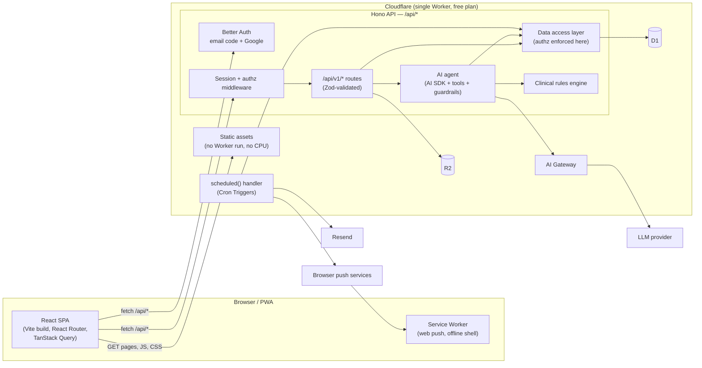

# Healthcare.AI — Technical Implementation Plan

| | |
|---|---|
| **Status** | Draft v2.0: architecture changed to SPA + API Worker after the Phase 1 spikes |
| **Last updated** | 2026-11-05 |
| **Companion doc** | [Product Requirements (PRD)](./PRD.md) |

This document describes how to take Healthcare.AI from its current state to the product defined in the PRD: the target architecture, the stack, the data model, and the build phases with exit criteria.

> **What changed in v2.** v1 planned Next.js on Cloudflare Workers. Spikes on the real free plan showed that a Next.js page render (~28 ms CPU) and password login (~146 ms) exceed the free plan's 10 ms CPU limit; about half of the auth requests were rejected with 503. The project stays on the **free** plan by splitting into a **static React app** (served free, without running code) and a **small Hono API Worker**, with **passwordless login**. Measured on the free plan: 72/72 API requests succeeded, data calls ~6–7 ms CPU. See [§13](#13-spike-findings).

---

## 1. Where the code is today

**Working:** the UI (landing page, auth pages, dashboard tabs, chat, report upload/gallery/QR pages), Supabase auth, some Supabase reads and writes, and a Gemini-backed chat that runs server-side.

**Phase 0 (done)** cleaned up the base:
- Leaked keys removed from code; `.env.local` untracked; `.env.example` added. *The old keys are still in git history and must be rotated.*
- Gemini key is server-only. Request format fixed (`systemInstruction`, JSON mode). Model is configurable (`GEMINI_MODEL`).
- Auth middleware moved to the project root so it actually runs.
- Dead code, duplicate pages, mock API routes and the unused SQLite/Turso layer removed.
- Type checking and lint are enforced in the build again.

**Still incomplete:**
- About 15 Supabase tables are used in code, but only 5 have a schema in the repo.
- Caretakers and some reminders are hard-coded component state.
- The chat's exercise, diet and risk buttons call a worker URL that doesn't exist (`app/utils/api.ts`).
- The client sends the patient's health data in the AI request body, and the server logs it.
- `PatientContext.tsx` (~870 lines) loads everything client-side through Supabase realtime.
- No tests, no CI, no notifications, no scheduled jobs.

**Reusable in the new architecture:** most UI lives in client components (`"use client"`) built with React, Tailwind and Framer Motion. These move to the Vite app largely unchanged; what changes is routing, data fetching and auth.

## 2. Key decisions

| Decision | Choice | Why |
|---|---|---|
| Cost target | **$0** on Cloudflare's free plan until there are real users | Upgrade path: Workers Paid ($5/month) with no code change. |
| Language | **TypeScript end to end** | One language for UI, API, jobs and agents; shared types and Zod schemas between client and server. |
| Frontend | **Vite + React 19 SPA**, **React Router**, **TanStack Query**, Tailwind, Framer Motion | Served as static assets: free, unmetered, no CPU. Existing client components are reused. |
| API | **Hono** on Cloudflare Workers | Tiny and fast (data calls ~6–7 ms CPU measured). Typed client (`hc`) gives end-to-end types from API to UI. |
| One deployable | A single Worker: static assets + `/api/*` routes + cron handler | `run_worker_first: ["/api/*"]`; everything else is served straight from assets with SPA fallback. One deploy, one domain, no CORS. |
| Dev tooling | **@cloudflare/vite-plugin** | `vite dev` runs the API in workerd (the real runtime) with local D1/R2. |
| Database | **Cloudflare D1** (SQLite) + **Drizzle ORM** | Free 5 GB, native binding, typed schema and migrations. |
| File storage | **Cloudflare R2** | 10 GB free, no egress fees. |
| Auth | **Better Auth**, **passwordless**: 6-digit email code (email-OTP plugin) and Google sign-in | Password hashing costs 60–150 ms CPU per login and doesn't fit the free plan. Codes are stored hashed. Simpler for older users too. |
| Email | **Resend** (HTTP API) via an outbox table | ~3,000 emails/month free. The outbox makes sending retryable and idempotent. |
| AI | **Vercel AI SDK** (`ai`) behind **Cloudflare AI Gateway** | Provider-agnostic streaming, tools and structured output. LLM waiting time is network I/O, not CPU. |
| LLM | **Gemini** (free tier) for development; choose the production model in Phase 4 | Swappable via the AI SDK. |
| Validation | **Zod**, shared by UI forms, API and AI tools | Schemas live in one place. |
| Heavy work in the browser | PDF generation, charts, image resizing before upload | Keeps the Worker within its CPU budget. |

## 3. Target architecture



**Request flow, chat example:**
1. The SPA posts only the message and conversation id to `/api/v1/chat`.
2. The API checks the session and the daily AI quota, then runs the **red-flag rules** on the message. If a rule matches, it returns the emergency response at once, without calling the LLM.
3. The agent loads the patient's context **server-side** through the data access layer (never trusting client-sent health data).
4. The answer streams back through AI Gateway. Read tools run directly; write tools return a *proposal* the UI shows as a confirm card.
5. Messages, tool calls and token usage are saved to D1.

## 4. Repository layout (target)

```
HealthCare.Ai/
├── index.html                    # SPA entry
├── src/
│   ├── client/                   # React SPA
│   │   ├── main.tsx  router.tsx
│   │   ├── routes/               # landing, auth, dashboard, vitals, medications,
│   │   │                         # symptoms, reports, timeline, chat, caretakers,
│   │   │                         # settings, care/:patientId, share/:token
│   │   ├── components/           # reused UI (ported from app/components)
│   │   ├── lib/  api.ts (typed hc client)  auth-client.ts  query.ts
│   │   └── sw.ts                 # service worker (push)
│   ├── worker/                   # Hono API + cron, runs on Workers
│   │   ├── index.ts              # app, route mounting, scheduled()
│   │   ├── auth.ts               # Better Auth (once per isolate)
│   │   ├── middleware/           # session, authz, rate limit, errors
│   │   ├── routes/               # vitals, meds, symptoms, reports, shares, care, chat
│   │   ├── dal/                  # data access layer (only place that touches db)
│   │   ├── db/  schema.ts  client.ts
│   │   ├── rules/                # thresholds, red flags (+ tests)
│   │   ├── ai/  agent.ts  tools.ts  prompts.ts  context.ts  guardrails.ts
│   │   ├── jobs/                 # reminders, missed doses, monitoring, outbox sender
│   │   └── notifications/        # email (Resend), web push
│   └── shared/                   # Zod schemas + types used by client and worker
├── drizzle/                      # SQL migrations
├── tests/  unit/  e2e/  ai-evals/
├── docs/   PRD.md  TECH_PLAN.md
├── vite.config.ts                # react() + cloudflare()
└── wrangler.jsonc                # assets, D1, R2, crons, AI Gateway
```

## 5. Data model (D1 / Drizzle)

All ids are text (UUID). Timestamps are UTC integers (ms). Each user has a timezone in their profile, used for scheduling.

| Table | Key columns | Notes |
|---|---|---|
| `user`, `session`, `account`, `verification` | Managed by Better Auth | `verification` also holds hashed email codes. |
| `rate_limit` | `key`, `count`, `last_request` | Better Auth rate limits; must be in D1 because memory is per-isolate on Workers. |
| `profiles` | `user_id` PK, `dob`, `sex`, `height_cm`, `country`, `timezone`, `units`, `conditions`, `allergies`, `family_history`, `lifestyle` (json), `had_heart_attack`, `last_heart_attack_at`, `emergency_contact` (json), `onboarded_at` | One per user. |
| `vitals` | `id`, `user_id`, `type` (hr, bp, spo2, weight, glucose, temp, cholesterol), `value`, `value2` (diastolic), `unit`, `measured_at`, `source`, `classification`, `note` | Index (`user_id`, `type`, `measured_at`). |
| `symptoms` | `id`, `user_id`, `type`, `severity` 1–10, `duration_min`, `accompanied_by` (json), `note`, `occurred_at` | |
| `medications` | `id`, `user_id`, `name`, `dose`, `form`, `instructions`, `schedule` (json), `start_date`, `end_date`, `active` | |
| `dose_events` | `id`, `medication_id`, `user_id`, `scheduled_at`, `status` (pending, taken, skipped, missed), `acted_at`, `notified_at` | Created ahead of time by cron. Drives adherence. |
| `reminders` | `id`, `user_id`, `kind` (appointment, custom), `title`, `due_at`, `repeat` (json), `next_run_at`, `notified_at` | |
| `reports` | `id`, `user_id`, `title`, `type`, `report_date`, `doctor`, `facility`, `r2_key`, `mime`, `size`, `note`, `extraction_status`, `summary` | |
| `report_findings` | `id`, `report_id`, `test`, `value`, `unit`, `ref_low`, `ref_high`, `flag`, `confirmed_by_user` | From the report reader agent. |
| `shares`, `share_items`, `share_access_log` | `token_hash`, `expires_at`, `revoked_at`, `include_vitals`; items; access log | Raw token exists only in the URL/QR. |
| `care_links` | `patient_id`, `caretaker_id`, `invited_email`, `invite_token_hash`, `status`, `permissions` (json), `alert_prefs` (json) | Basis of all caretaker access. |
| `alerts` | `user_id`, `severity`, `source` (rule, agent), `kind`, `title`, `body`, `data`, `acknowledged_at` | |
| `outbox` | `id`, `channel` (email, push), `recipient`, `kind`, `payload`, `status`, `attempts`, `sent_at` | All outgoing messages, including login codes. Drained by cron (and immediately for login codes). |
| `push_subscriptions` | `user_id`, `endpoint`, `keys` (json) | |
| `conversations`, `messages` | `role`, `content`, `tool_calls` (json), `tokens_in`, `tokens_out`, `rating` | |
| `ai_usage` | (`user_id`, `day`) PK, `requests`, `tokens` | Daily quota. |
| `consents` | `user_id`, `kind`, `version`, `granted_at` | |
| `audit_log` | `actor_id`, `subject_user_id`, `action`, `entity`, `entity_id`, `at` | Access by anyone other than the owner, plus sensitive actions. |

## 6. Security and authorization

D1 has **no row-level security**, so authorization is enforced in one place: the data access layer.

- **Every DAL function takes the acting user** and a target `patientId`, and calls `canAccess(actor, patientId, permission)` first. Routes and AI tools never query tables directly; only `src/worker/dal` imports the db client.
- Permissions: `owner` (everything); caretakers per `care_links.permissions` (`vitals`, `meds`, `reports`, `alerts`).
- **Authorization tests** for every DAL function: user B can't read or write user A's data; a caretaker without a permission is denied.
- **Login:** email codes are 6 digits, stored hashed, expire in 5 minutes, allow 3 attempts, and are rate-limited per email and per IP (Better Auth limiter in D1). Session cookies are `HttpOnly`, `Secure`, `SameSite=Lax`. Better Auth checks the request `Origin`.
- **Share links:** 32 random bytes, stored as SHA-256 hash, with expiry and revocation; every open is logged.
- **Files:** never public. Downloads go through an access-checked route that streams from R2. Uploads are size- and type-checked.
- **Secrets:** `wrangler secret put` in production, `.dev.vars` locally (git-ignored). The SPA bundle is public by definition, so it holds no secrets at all.
- **Headers:** CSP, HSTS, `X-Content-Type-Options`, `Referrer-Policy`, `Permissions-Policy` (camera allowed for QR scanning only) via a `_headers` file for assets and Hono middleware for the API.
- **Logging:** never log health data, prompts or login codes.
- **Backups:** D1 Time Travel (point-in-time restore) plus a weekly export to R2.

## 7. AI architecture

### 7.1 Layers
1. **Rules engine (`src/worker/rules`)**: vital thresholds and red-flag symptom combinations as pure functions with a full test suite. Runs before every AI call and on every vital or symptom saved. Also shipped to the SPA so the emergency banner works offline.
2. **Context builder**: loads a compact, minimal patient summary from the DAL.
3. **Agent**: AI SDK `streamText` with system prompt, context, history and tools, with a step limit.
4. **Guardrails**: input check (red flags → emergency response); output check (no start/stop/dose instructions; "when to seek care" for symptom answers).

### 7.2 Tools
| Tool | Type | Confirmation |
|---|---|---|
| `getVitals`, `getVitalTrend`, `getMedications`, `getAdherence`, `getReports`, `getReportFindings` | read | no |
| `logSymptom`, `logVital`, `createReminder` | write | **yes**: confirm card in the UI |
| `notifyCaretaker` | external | **yes** |
| `emergencyGuidance` | read | no |

Write tools return a *proposal*; confirming calls a normal API route that runs the same DAL function.

### 7.3 Agents beyond chat
- **Report reader:** after upload, send the PDF/image to a vision model with `generateObject` and a Zod schema. Save `report_findings`, flag out-of-range values, write a summary; the user reviews and confirms.
- **Monitoring agent (daily cron):** deterministic trend and adherence checks in code; the LLM only writes the readable insight. Serious findings create alerts and notify caretakers.
- **Visit prep:** the API returns the assembled data and an LLM-written narrative; **the browser renders the PDF**, keeping that CPU off the Worker.

### 7.4 Quality, cost and CPU
- **AI evaluation set** (`tests/ai-evals`, ~50 prompts) run in CI on prompt or model changes: emergency routing, no dosing advice, grounded answers.
- Thumbs up/down per answer; per-user daily quota; AI Gateway logging, caching and spend cap.
- **CPU:** waiting on the LLM doesn't count, but parsing a long stream does a little work per chunk. Measure chat CPU in Phase 4; if it runs over budget, stream from the LLM straight to the client and save the transcript once at the end.

## 8. Background jobs (`scheduled()` in the same Worker)

| Schedule | Job |
|---|---|
| Every minute | Drain the outbox (login codes are also sent immediately); send due medication and custom reminders. |
| Every 5 minutes | Mark doses missed after the window; escalate to caretakers per their preferences. |
| Hourly | Create `dose_events` for the next 48 h in each user's timezone (idempotent). |
| Daily | Monitoring agent; clean up expired shares and invites; weekly D1 export to R2. |

Every job is idempotent (`notified_at`, outbox status) and works in **small batches**, so each invocation stays within the CPU budget. If Queues are available on the account's plan, fan-out work moves there.

## 9. CPU and free-tier budget

| Service | Free allowance (approx., verify before building) | Notes |
|---|---|---|
| Workers | 100k requests/day; **10 ms CPU per invocation** | Static asset requests are free and don't run the Worker. Measured: data APIs ~6–7 ms, login ~11–22 ms (tolerated). |
| D1 | 5 GB storage; daily read/write row limits | Index every query by `user_id`; paginate. |
| R2 | 10 GB storage, free egress | Resize images in the browser before upload. |
| Cron Triggers | A few per account | One cron per frequency; dispatch inside. |
| AI Gateway | Free core features | |
| Gemini API | Free tier with per-minute and daily limits | Per-user quotas; plan a paid model for launch. |
| Resend | ~3,000 emails/month | Login codes count toward this. |

**CPU rules for every route:**
1. Create Better Auth and other heavy objects **once per isolate**, not per request.
2. Enable Better Auth's **session cookie cache** so most calls skip the D1 session lookup.
3. Compile Zod schemas at module load; keep payloads small; paginate lists.
4. Push heavy work to the browser (PDF, charts, image processing) or to network-bound calls (LLM).
5. CI prints the Worker bundle size; production alerts on any `exceededCpu` outcome in Workers observability.

**Upgrade trigger:** if `exceededCpu` shows up in production, or AI/chat routes can't be kept within budget, move to Workers Paid ($5/month). No code changes needed.

## 10. Testing, CI and environments

- **Unit (Vitest):** rules engine (100% branch coverage on thresholds and red flags), authz, DAL, schedule expansion, timezones.
- **Integration (Vitest + `@cloudflare/vitest-pool-workers`):** API routes against local D1 in workerd.
- **End to end (Playwright):** sign in with email code (read from the local outbox) → onboard → log vitals (normal and critical) → add medication → upload report → share → open the link logged out → revoke.
- **AI evals:** see §7.4.
- **CI (GitHub Actions)** on every PR: install, typecheck, lint, tests, build, bundle-size report. On `main`: apply D1 migrations, then `wrangler deploy`.
- **Environments:** local (`vite dev` with workerd, `.dev.vars`), preview/staging Worker with its own D1 and R2, production.

## 11. Build phases

Each phase ends with a deployable app. Effort assumes one developer working part-time.

### Phase 0 — Cleanup and security ✅ *done*

### Phase 1 — New foundation: SPA + API on Cloudflare (≈ 3–4 weeks)
**Goal:** the app runs on Cloudflare's free plan with its own auth, database and storage. Next.js and Supabase are gone.

1. ✅ Spikes: Next.js on Workers (failed the CPU limit) and SPA + Hono (passed). See §13.
2. Scaffold in the repo: Vite + React + `@cloudflare/vite-plugin`, Hono Worker, `wrangler.jsonc` (assets with SPA fallback, D1, R2), Tailwind, path aliases, `.dev.vars`.
3. Drizzle schema (§5) and first migrations.
4. Better Auth passwordless: email code + Google, auth instance per isolate, cookie cache, D1 rate limiting, outbox + Resend sender. Login and verify pages in the SPA.
5. DAL + `canAccess` + authorization tests; Hono session middleware.
6. Port the UI: landing, auth, dashboard shell and navigation to React Router. Move components from `app/components` to `src/client/components`, replacing Next-specific APIs (`next/link`, `next/navigation`, `next/image`) with React Router and plain elements.
7. Replace Supabase data access feature by feature (profile → vitals → medications → symptoms → reports on R2 → sharing), using TanStack Query and typed `hc` calls.
8. Remove Next.js, `@supabase/*` and old config files.
9. CI (typecheck, lint, test, build) and deploy to `*.workers.dev`.
10. Data migration only if real Supabase data exists (CSV export → import script); otherwise start fresh.

**Exit criteria:** on the deployed URL, a user can sign in with an email code, save a profile, add vitals and upload a report that persist across sessions. No Next.js or Supabase code remains. CI is green. Zero `exceededCpu` across the E2E run.

### Phase 2 — MVP feature-complete, release R1 (≈ 3–4 weeks)
1. Onboarding wizard (PRD A-3).
2. Vitals forms for all types, rules-engine classification, trend charts (one chart library: Recharts).
3. Medications CRUD; symptoms log; unified timeline.
4. Reports gallery, filters, secure download route.
5. Sharing: hashed tokens, expiry choices, multiple reports per share, access log, revoke, public `/share/:token` page, QR.
6. Rules engine and emergency UI (PRD E-1, E-2, E-4) with full tests.
7. Chat rebuilt on the AI SDK: streaming, server-side context, persisted conversations, daily quota, honest fallback.
8. Remove the broken quick-action calls (`app/utils/api.ts`); reimplement them as chat prompts.
9. Security headers; no health data in logs.
10. Consolidate duplicate libraries (one chart library, one icon set, one QR scanner).
11. Playwright suite for the MVP flows.

**Exit criteria:** every PRD R1 P0 requirement passes its acceptance check; E2E suite green; no mock data anywhere.

### Phase 3 — Reminders, caretakers, notifications, release R2 (≈ 3 weeks)
1. `scheduled()` jobs: dose event generation (timezone-aware), reminders, missed-dose detection, outbox sender.
2. Web Push: service worker, VAPID keys (Web Crypto–based push library), subscription management; email fallback.
3. Adherence calculation and UI; taken/skipped/snooze from notifications.
4. Caretaker invites (email token), acceptance, permissions UI, removal.
5. Caretaker dashboard (`/care/:patientId`) through the same DAL.
6. Escalation rules and quiet hours.
7. PWA manifest and install prompt.

**Exit criteria:** a reminder arrives on a phone within 2 minutes of schedule; a missed dose alerts the caretaker; removing a caretaker immediately ends access (tested).

### Phase 4 — Agentic AI, release R3 (≈ 3–4 weeks)
1. Tool definitions (§7.2) with Zod schemas; confirm-card UI.
2. Guardrails module and AI eval suite in CI.
3. Report reader: extraction, findings review UI, summaries.
4. Monitoring agent (daily).
5. Visit-prep summary with browser-rendered PDF.
6. AI Gateway; choose the production model using the eval set; measure chat CPU (§7.4).

**Exit criteria:** eval suite passes (100% emergency routing, 0 medication-change instructions); report reader ≥ 90% field accuracy on sample reports; every write tool requires confirmation; chat routes have no `exceededCpu`.

### Phase 5 — Hardening and launch, release R4 (≈ 2–3 weeks)
1. Audit log; data export and account deletion (including R2 files).
2. Privacy policy, terms, consent capture and versioning.
3. Error tracking (e.g. Sentry free tier) and uptime checks.
4. Accessibility audit (WCAG 2.1 AA).
5. Backups verified with a restore drill.
6. Clinician review of thresholds, red-flag rules and prompts.
7. Custom domain; upgrade to Workers Paid if CPU or request limits are hit.

**Exit criteria:** security checklist complete, restore drill done, clinician sign-off, launch.

## 12. Must-not-miss items

1. **Rotate the keys** that were committed (Gemini, Supabase, DeepSeek).
2. **No RLS in D1**: all data access goes through the DAL with authorization tests.
3. **Never trust client-sent health data for AI**: load context server-side.
4. **Red-flag rules run before and independently of the LLM**, and also in the browser.
5. **CPU budget per route** (§9): auth once per isolate, cookie cache, heavy work in the browser, alert on `exceededCpu`.
6. **The SPA is public code**: no secrets, and every check that matters happens in the API.
7. **Timezones**: store UTC, schedule in the user's timezone, test daylight-saving changes.
8. **Share tokens hashed**, expiring and revocable; files only through access-checked routes.
9. **No health data or login codes in logs.**
10. **Idempotent jobs and the outbox**, so reminders and codes are never double-sent or lost.

## 13. Spike findings

Run on 2026-11-05 against the real Cloudflare free plan. Spike code lives outside the repo (`rebuild-hc/spikes/`).

**Spike A: Next.js 16 + OpenNext + D1 + Better Auth (passwords).** Worked functionally, but:

| Request | CPU median | Outcome |
|---|---|---|
| Sign-in / sign-up, scrypt (default) | ~146 ms | Rejected (`exceededCpu`, 503) after a short burst |
| Sign-in / sign-up, PBKDF2 100k | ~63 ms | Also rejected after the burst |
| Server-rendered page reading the session | ~28 ms | Rejected once |

About half of all auth requests failed. Bundle 1.5 MB gzipped.

**Spike B: Vite React SPA + Hono API + D1 + Better Auth (email codes).** 72/72 requests succeeded, 0 `exceededCpu`. Static pages and deep links never ran the Worker. Bundle 380 KB gzipped; build under 1 second.

| Route | CPU median | p90 |
|---|---|---|
| Insert vital | 6 ms | 10 ms |
| List vitals | 7 ms | 13 ms |
| Session check (`/me`) | 7 ms | 12 ms |
| Send login code | 11 ms | 44 ms |
| Sign in with code | 22 ms | 44 ms |

Login runs over 10 ms but was always allowed (rare, short requests). Ordinary data calls fit the budget.

## 14. Future options (post-R4)
- Wearables and health platforms (Apple Health via an iOS companion, Google Health Connect, Fitbit).
- SMS/WhatsApp notifications (paid providers).
- Native apps (React Native / Expo) using the same Hono API and shared Zod schemas.
- Doctor accounts with a multi-patient view (requires a compliance review).
- Moving to AWS (RDS Postgres, S3, Bedrock) if scale or compliance requires a signed BAA.
