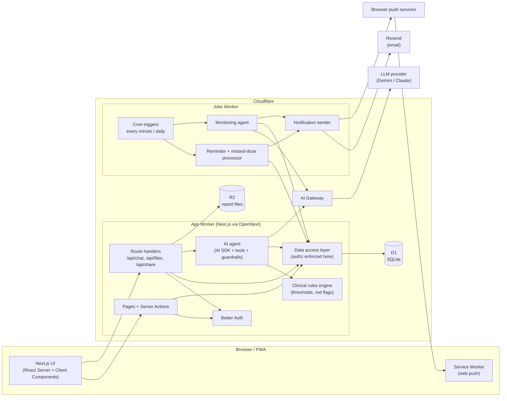

# Healthcare.AI — Technical Implementation Plan

| | |
|---|---|
| **Status** | Draft v1.0 |
| **Last updated** | 2026-11-05 |
| **Companion doc** | [Product Requirements (PRD)](./PRD.md) |

This document describes how to take Healthcare.AI from its current state to the product defined in the PRD: the target architecture, the stack, the data model, and the build phases with exit criteria.

---

## 1. Where the code is today

**Working:** the UI (landing page, auth pages, dashboard tabs, chat, report upload/gallery/QR pages), Supabase auth, some Supabase reads and writes, and a Gemini-backed chat that runs server-side.

**Phase 0 (done)** cleaned up the base:
- Leaked keys removed from code; `.env.local` untracked; `.env.example` added. *The old keys are still in git history and must be rotated.*
- Gemini key is server-only. Request format fixed (`systemInstruction`, JSON mode). Model is configurable (`GEMINI_MODEL`).
- Auth middleware moved to the project root so it actually runs. Pages redirect to login and APIs return 401.
- Dead code, duplicate pages, mock API routes and the unused SQLite/Turso layer removed.
- Type checking and lint are enforced in the build again.

**Still incomplete:**
- About 15 Supabase tables are used in code, but only 5 have a schema in the repo.
- Caretakers and some reminders are hard-coded component state.
- The chat's exercise, diet and risk buttons call a worker URL that doesn't exist (`app/utils/api.ts`).
- The client sends the patient's health data in the AI request body, and the server logs it.
- `PatientContext.tsx` (~870 lines) loads everything client-side through Supabase realtime.
- No tests, no CI, no notifications, no scheduled jobs.

## 2. Key decisions

| Decision | Choice | Why |
|---|---|---|
| Language | **TypeScript end to end** | ~15k lines of TS already, mostly UI. One language for UI, API, jobs and agents. Python only if custom ML is needed later, as a separate service. |
| Framework | **Next.js 15 (App Router)** | Upgrade from 14. Best-supported version for the Cloudflare adapter. Server Components remove most of the client-side data plumbing. |
| Hosting | **Cloudflare Workers** via **OpenNext** (`@opennextjs/cloudflare`) | Permanent free tier, no credit card, global edge. |
| Database | **Cloudflare D1** (SQLite) + **Drizzle ORM** | Free 5 GB, native binding from Workers, typed schema and migrations. |
| File storage | **Cloudflare R2** | 10 GB free, no egress fees. |
| Auth | **Better Auth** (Drizzle adapter on D1) | Self-hosted in the app, users stored in our own DB, email/password plus Google, no vendor lock-in. |
| AI | **Vercel AI SDK** (`ai`) behind **Cloudflare AI Gateway** | Provider-agnostic streaming, tools and structured output. The gateway adds logging, caching and rate limits. |
| LLM | **Gemini** (free tier) for development; choose the production model at Phase 4 | Swappable through the AI SDK (e.g. `@ai-sdk/google`, `@ai-sdk/anthropic`). |
| Background jobs | Separate **jobs Worker** with Cron Triggers (and Queues if available on your plan) | Reminders, missed-dose detection, monitoring agent. |
| Notifications | **Web Push** (VAPID) + **email** (Resend, HTTP API) | Both have free tiers and work from Workers. SMS/WhatsApp later if needed. |
| Validation | **Zod** everywhere (forms, API, AI tool inputs, AI structured output) | One schema language across all boundaries. |

> **Why not keep Supabase?** It works, but the free project pauses when idle, and auth, data and storage are tied to one vendor. Moving to Cloudflare puts hosting, data, files and jobs on one free platform. The trade-off: **D1 has no row-level security**, so authorization moves into our code (see §6).

## 3. Target architecture



**Request flow, chat example:**
1. The browser posts only the message and conversation id to `/api/chat`.
2. The server authenticates, checks the daily AI quota and runs the **red-flag rules** on the message. If a rule matches, it returns the emergency response immediately, without calling the LLM.
3. The agent loads the patient's context **server-side** through the data access layer (never trusting client-sent health data).
4. The agent streams the answer through AI Gateway. It may call read tools; write tools return a *proposal* that the UI renders as a confirm card.
5. Messages, tool calls and token usage are saved to D1.

## 4. Repository layout (target)

```
HealthCare.Ai/
├── app/                          # Next.js routes only (thin)
│   ├── (marketing)/              # landing page
│   ├── (auth)/                   # login, signup, verify, reset
│   ├── (app)/                    # authenticated area
│   │   ├── dashboard/  vitals/  medications/  symptoms/
│   │   ├── reports/  timeline/  chat/  caretakers/  settings/
│   │   └── care/[patientId]/     # caretaker view of a patient
│   ├── share/[token]/            # public read-only shared records
│   └── api/                      # auth, chat, files, push subscribe
├── components/                   # UI components (ui/ = shadcn primitives)
├── server/                       # server-only code
│   ├── db/  schema.ts  client.ts  migrations/
│   ├── auth.ts                   # Better Auth config
│   ├── dal/                      # data access layer, one file per entity
│   ├── authz.ts                  # requireUser, canAccess(patient, permission)
│   ├── rules/                    # vitals thresholds, red-flag symptoms (+ tests)
│   ├── ai/  agent.ts  tools.ts  prompts.ts  context.ts  guardrails.ts
│   ├── files.ts                  # R2 helpers
│   └── notifications/            # push, email
├── workers/jobs/                 # separate Worker: cron handlers
├── lib/                          # shared, isomorphic helpers + Zod schemas
├── tests/  unit/  e2e/  ai-evals/
├── docs/   PRD.md  TECH_PLAN.md
├── wrangler.jsonc                # app Worker bindings (D1, R2, AI Gateway)
└── open-next.config.ts
```

## 5. Data model (D1 / Drizzle)

All ids are text (UUID v7 or nanoid). All timestamps are stored as UTC integers (ms). Each user has a timezone in their profile, used for scheduling.

| Table | Key columns | Notes |
|---|---|---|
| `user`, `session`, `account`, `verification` | Managed by Better Auth | |
| `profiles` | `user_id` PK, `dob`, `sex`, `height_cm`, `country`, `timezone`, `units`, `conditions` (json), `allergies` (json), `family_history` (json), `lifestyle` (json), `had_heart_attack`, `last_heart_attack_at`, `emergency_contact` (json), `onboarded_at` | One per user. |
| `vitals` | `id`, `user_id`, `type` (hr, bp, spo2, weight, glucose, temp, cholesterol), `value`, `value2` (diastolic), `unit`, `measured_at`, `source` (manual, import, agent), `classification`, `note` | Index (`user_id`, `type`, `measured_at`). |
| `symptoms` | `id`, `user_id`, `type`, `severity` 1–10, `duration_min`, `accompanied_by` (json), `note`, `occurred_at` | |
| `medications` | `id`, `user_id`, `name`, `dose`, `form`, `instructions`, `schedule` (json: times, days), `start_date`, `end_date`, `active` | |
| `dose_events` | `id`, `medication_id`, `user_id`, `scheduled_at`, `status` (pending, taken, skipped, missed), `acted_at`, `notified_at` | Created ahead of time by the jobs Worker. Drives adherence. |
| `reminders` | `id`, `user_id`, `kind` (appointment, custom), `title`, `due_at`, `repeat` (json), `next_run_at`, `notified_at` | Non-medication reminders. |
| `reports` | `id`, `user_id`, `title`, `type`, `report_date`, `doctor`, `facility`, `r2_key`, `mime`, `size`, `note`, `extraction_status`, `summary` | |
| `report_findings` | `id`, `report_id`, `test`, `value`, `unit`, `ref_low`, `ref_high`, `flag`, `confirmed_by_user` | Filled by the report reader agent. |
| `shares` | `id`, `user_id`, `token_hash`, `expires_at`, `revoked_at`, `include_vitals`, `created_at` | The raw token exists only in the URL/QR. |
| `share_items` | `share_id`, `report_id` | |
| `share_access_log` | `id`, `share_id`, `at`, `ip_hash`, `user_agent` | |
| `care_links` | `id`, `patient_id`, `caretaker_id`, `invited_email`, `invite_token_hash`, `status` (invited, active, revoked), `permissions` (json), `alert_prefs` (json) | Basis of all caretaker access. |
| `alerts` | `id`, `user_id`, `severity`, `source` (rule, agent), `kind`, `title`, `body`, `data` (json), `acknowledged_at` | |
| `notifications` | `id`, `recipient_id`, `channel`, `kind`, `payload`, `status`, `attempts`, `sent_at` | Outbox; makes sending idempotent and retryable. |
| `push_subscriptions` | `id`, `user_id`, `endpoint`, `keys` (json), `created_at` | |
| `conversations`, `messages` | `role`, `content`, `tool_calls` (json), `tokens_in`, `tokens_out`, `rating` | Chat history and feedback. |
| `ai_usage` | (`user_id`, `day`) PK, `requests`, `tokens` | Daily quota. |
| `consents` | `user_id`, `kind`, `version`, `granted_at` | Terms, privacy, AI processing. |
| `audit_log` | `id`, `actor_id`, `subject_user_id`, `action`, `entity`, `entity_id`, `at` | Every access by someone other than the owner, plus sensitive actions. |

## 6. Security and authorization

D1 has **no row-level security**, so authorization is enforced in one place: the data access layer.

- **Every DAL function takes the acting user** and a target `patientId`, and calls `canAccess(actor, patientId, permission)` first. Pages, actions and AI tools never query tables directly. A lint rule or code review blocks `db` imports outside `server/dal`.
- Permissions: `owner` (everything); for caretakers, the `care_links.permissions` flags (`vitals`, `meds`, `reports`, `alerts`).
- **Authorization tests**: for every DAL function, a test proves that user B can't read or write user A's data and that a caretaker without a permission is denied.
- **Share links**: 32 random bytes, base64url, stored as SHA-256 hash, with expiry and revocation. Every open is logged. The share page only reaches data through the share's items.
- **Files**: report files are never public. Downloads go through a route that checks access, then streams from R2.
- **Secrets**: `wrangler secret put` for production, `.dev.vars` locally (git-ignored). Nothing secret uses `NEXT_PUBLIC_`.
- **Rate limits**: login and signup, AI chat (daily quota per user plus per-minute), share-link opens.
- **Logging**: never log health data or prompts. Today's code logs AI request bodies with `console.log`; this must be removed in Phase 2.
- **Backups**: D1 Time Travel (point-in-time restore) plus a weekly export to R2 from the jobs Worker.

## 7. AI architecture

### 7.1 Layers
1. **Rules engine (deterministic, `server/rules`)**: vital thresholds and red-flag symptom combinations. Pure functions with a full test suite. Runs before every AI call, on every vital or symptom saved, and in the jobs Worker. Works when the LLM is down.
2. **Context builder (`server/ai/context.ts`)**: loads a compact, minimal summary of the patient from the DAL: profile, latest vitals and 30-day trend, active meds and adherence, recent symptoms, report summaries.
3. **Agent (`server/ai/agent.ts`)**: AI SDK `streamText` with system prompt, context, conversation history and tools. Step limit to stop runaway loops.
4. **Guardrails (`server/ai/guardrails.ts`)**: input check (red flags → emergency response), output check (blocks medication start/stop/dose instructions, adds "when to seek care" for symptom answers).

### 7.2 Tools
| Tool | Type | Confirmation |
|---|---|---|
| `getVitals(type, range)`, `getVitalTrend(type, days)` | read | no |
| `getMedications()`, `getAdherence(days)` | read | no |
| `getReports(filter)`, `getReportFindings(reportId)` | read | no |
| `logSymptom(...)`, `logVital(...)` | write | **yes**: UI confirm card |
| `createReminder(...)` | write | **yes** |
| `notifyCaretaker(message)` | external | **yes** |
| `emergencyGuidance()` | read | no (always available) |

Write tools return a *proposal* object. The UI shows a confirm card, and confirming calls a server action that runs the same DAL function. The model never writes data directly.

### 7.3 Agents beyond chat
- **Report reader**: on upload, the jobs Worker (or the upload request) sends the PDF/image to a vision-capable model with `generateObject` and a Zod schema (test, value, unit, reference range). Saves `report_findings`, flags out-of-range values, writes a plain summary. The user reviews and confirms.
- **Monitoring agent (daily cron)**: the rules engine computes trends and adherence deterministically; the LLM only writes the human-readable insight. Serious findings create `alerts` and notify caretakers.
- **Visit prep**: assembles the data via the DAL, the LLM writes the narrative, the PDF is rendered server-side and stored in R2.

### 7.4 Quality and cost
- **AI evaluation set** (`tests/ai-evals`): ~50 prompts: emergencies, medication-change requests, out-of-scope questions, questions about the user's own data. Each run checks required behaviours (emergency routing, no dosing advice, grounded answers). Runs in CI on prompt or model changes.
- Thumbs up/down on every answer, stored in `messages.rating`.
- AI Gateway for logs, caching and a spend cap. Per-user daily quota in `ai_usage`.

## 8. Background jobs (jobs Worker)

| Schedule | Job |
|---|---|
| Every minute | Send due medication reminders (`dose_events` pending and due, not notified). Send due custom/appointment reminders. Retry failed notifications from the outbox. |
| Every 5 minutes | Mark doses missed after the window; escalate to caretakers per their preferences. |
| Hourly | Create `dose_events` for the next 48 h from active medication schedules, in each user's timezone (idempotent). |
| Daily | Monitoring agent; clean up expired shares and invites; weekly D1 export to R2. |

Every job is idempotent: it uses `notified_at` and the `notifications` outbox so retries never double-send.

## 9. Free-tier budget (verify current limits before building)

| Service | Free allowance (approx.) | Expected pressure |
|---|---|---|
| Workers | 100k requests/day, **~10 ms CPU per request** | **CPU is the real risk**: password hashing and heavy server rendering. Spike in Phase 1. Workers Paid is $5/month. |
| D1 | 5 GB storage; daily row read/write limits | Fine for hundreds of users. Index every query by `user_id`. |
| R2 | 10 GB, free egress | Fine. |
| Cron Triggers | A few per account | Use one cron per frequency and dispatch inside. |
| AI Gateway | Free core features | Logging, caching, rate limits. |
| Gemini API | Free tier with per-minute and daily limits | Per-user quotas and caching. Plan a paid model for launch. |
| Resend | ~3,000 emails/month | Fine at small scale. |

## 10. Testing, CI and environments

- **Unit (Vitest)**: rules engine (100% branch coverage on thresholds and red flags), authz, DAL, schedule expansion, timezone handling.
- **Integration**: DAL and route handlers against a local D1 (Wrangler/Miniflare).
- **End to end (Playwright)**: sign up → onboard → log vital (normal and critical) → add medication → upload report → share → open link logged out → revoke.
- **AI evals**: see §7.4.
- **CI (GitHub Actions)** on every PR: install, typecheck, lint, unit and integration tests, build. On `main`: apply D1 migrations, then deploy both Workers with `wrangler`.
- **Environments**: local (`next dev` with Cloudflare bindings via `getPlatformProxy`, `.dev.vars`); preview (separate Worker + D1 per PR, or a shared staging); production. Separate D1 databases and R2 buckets per environment.

## 11. Build phases

Each phase ends with a deployable app. Effort assumes one developer working part-time.

### Phase 0 — Cleanup and security ✅ *done*
See §1.

### Phase 1 — Cloudflare foundation (≈ 2–3 weeks)
**Goal:** the app runs on Cloudflare with its own auth, database and storage. Supabase is gone.

1. **Spikes first (2–3 days):**
   - Deploy a minimal Next.js 15 app to Workers with OpenNext.
   - Measure Better Auth sign-up/login CPU time on the free plan. If it exceeds the limit, decide between Workers Paid and a lighter hashing setup.
2. Upgrade Next.js 14 → 15 and React 18 → 19; fix breaking changes.
3. Add `wrangler.jsonc`, `open-next.config.ts`, D1 and R2 bindings, `.dev.vars`.
4. Write the Drizzle schema (§5) and the first migration.
5. Integrate Better Auth: email/password, verification and reset emails via Resend, Google OAuth. Rebuild the login, signup, verify and reset pages on it.
6. Build `server/authz.ts` and the DAL with authorization tests.
7. Replace every Supabase call, in this order: profile → vitals → medications → symptoms → reports (R2) → sharing.
8. Replace `PatientContext` realtime with Server Components and server actions; keep a small client store only where needed.
9. Remove `@supabase/*` packages and Supabase env vars.
10. Set up GitHub Actions CI and deploy to `*.workers.dev`.
11. Data migration: if any real Supabase data exists, export it to CSV and import with a script. Otherwise start fresh.

**Exit criteria:** on the deployed URL, a user can sign up, verify email, log in, save a profile, add vitals and upload a report that persists across sessions. No Supabase code remains. CI is green.

### Phase 2 — MVP feature-complete, release R1 (≈ 3–4 weeks)
1. Onboarding wizard (PRD A-3).
2. Vitals: forms for all types, rules-engine classification, trend charts (one chart library: Recharts).
3. Medications CRUD; symptoms log; unified timeline.
4. Reports: gallery, filters, secure download route.
5. Sharing: hashed tokens, expiry choices, multiple reports per share, access log, revoke, public `/share/[token]` page, QR.
6. Rules engine and emergency UI (PRD E-1, E-2, E-4) with full tests.
7. Chat rebuilt on the AI SDK: streaming, server-side context, persisted conversations, daily quota, honest fallback (no keyword mock answers presented as AI).
8. Remove the broken `app/utils/api.ts` worker calls; reimplement those quick actions as chat prompts.
9. Remove health data from logs; add security headers in middleware or the Worker.
10. Consolidate duplicate libraries: one chart library, one icon set, one QR scanner.
11. Playwright end-to-end suite for the MVP flows.

**Exit criteria:** every PRD R1 P0 requirement passes its acceptance check. E2E suite green. No mock data anywhere.

### Phase 3 — Reminders, caretakers, notifications, release R2 (≈ 3 weeks)
1. Jobs Worker with cron triggers sharing the Drizzle schema.
2. Dose event generation (timezone-aware), reminder sending, taken/skipped/snooze actions from push notifications.
3. Web Push: service worker, VAPID keys, subscription management. Email fallback.
4. Adherence calculation and UI.
5. Caretaker invite flow (email token), acceptance, permissions UI, removal.
6. Caretaker dashboard (`/care/[patientId]`) through the same DAL with permission checks.
7. Escalation: missed doses and critical vitals notify opted-in caretakers; quiet hours.
8. PWA manifest and install prompt.

**Exit criteria:** a reminder arrives on a phone within 2 minutes of schedule; a missed dose alerts the caretaker; removing a caretaker immediately ends their access (tested).

### Phase 4 — Agentic AI, release R3 (≈ 3–4 weeks)
1. Tool definitions (§7.2) with Zod schemas; confirm-card UI for write tools.
2. Guardrails module and AI evaluation suite in CI.
3. Report reader: extraction, findings review UI, summaries.
4. Monitoring agent (daily) creating alerts and insights.
5. Visit-prep PDF.
6. AI Gateway (logging, caching, spend cap); choose the production model and compare quality on the eval set.

**Exit criteria:** eval suite passes (100% emergency routing, 0 medication-change instructions); report reader extracts values from sample lab reports with ≥ 90% field accuracy; every write tool requires confirmation.

### Phase 5 — Hardening and launch, release R4 (≈ 2–3 weeks)
1. Audit log for non-owner access and sensitive actions.
2. Data export and account deletion (including R2 files).
3. Privacy policy, terms, consent capture and versioning.
4. Rate limiting on all public and expensive endpoints.
5. Error tracking (e.g. Sentry free tier) and uptime checks.
6. Accessibility audit (WCAG 2.1 AA) and fixes.
7. Backups verified with a restore drill.
8. Clinician review of thresholds, red-flag rules and prompts.
9. Custom domain and production environment; move to paid tiers if limits are hit.

**Exit criteria:** security checklist complete, restore drill done, clinician sign-off, launch.

## 12. Must-not-miss items

1. **Rotate the keys** that were committed (Gemini, Supabase, DeepSeek). Removing them from the code doesn't remove them from git history.
2. **No RLS in D1**: all data access goes through the DAL with authorization tests. This is the most important security property of the new stack.
3. **Never trust client-sent health data for AI**: load context server-side.
4. **Red-flag rules run before and independently of the LLM.**
5. **Timezones**: store UTC, schedule in the user's timezone, test daylight-saving changes.
6. **Share tokens hashed**, expiring and revocable; files only through access-checked routes.
7. **Free-plan CPU limit**: test auth and heavy pages on Workers early (Phase 1 spike).
8. **No health data in logs.**
9. **Clinical thresholds** documented with sources and reviewed by a clinician.
10. **Idempotent jobs and an outbox** so reminders are never double-sent or lost.

## 13. Future options (post-R4)
- Wearables and health platforms (Apple Health via an iOS companion, Google Health Connect, Fitbit).
- SMS/WhatsApp notifications (paid providers).
- Native apps (React Native / Expo) on the same API.
- Doctor accounts with multi-patient view (would require a compliance review).
- Moving to AWS (RDS Postgres, S3, Bedrock) if scale or compliance requires a signed BAA. Drizzle keeps the move manageable, but SQLite → Postgres needs a migration step.
